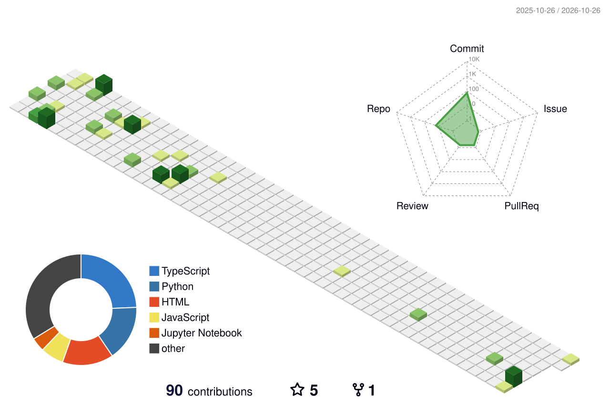

<div align="center">


### `[ FULL-STACK DEVELOPER ]` · `[ BACKEND / AI / SYSTEMS ]`

**Ship deployable systems, not demos.**

A small pixel garden for the software I build, the systems I learn, and the problems I solve.

[GitHub](https://github.com/Jaiprasadpugazhendi) · [LinkedIn](https://www.linkedin.com/in/jaiprasadp/) · Contact via LinkedIn


</div>

---

## ░▒▓ PLAYER PROFILE

```yaml
name: Jaiprasad Pugazhendi
role: Full-Stack Software Developer
base: India

building:
  - Production-minded web applications
  - Backend APIs and authentication flows
  - Data-driven tools and AI-powered features

engineering_values:
  - Security and access control
  - Data integrity
  - Maintainable architecture
  - Useful, deployable outcomes

open_to:
  - Full-time opportunities
  - Freelance projects
  - Open-source collaboration
```

## ░▒▓ THE TOOL SHED

<div align="center">

**LANGUAGES**


**FRONTEND**


**BACKEND & DATA**


**AI / TOOLS**


</div>

## ░▒▓ BUILDS IN THE GARDEN

### 01 / Face Recognition System
A computer-vision project exploring face detection and recognition.

**Stack:** Python · OpenCV · Flask · Machine Learning

[Open repository →](https://github.com/Jaiprasadpugazhendi/based-on-face-recognition)

### 02 / Electronics Shop
An e-commerce project focused on product browsing and a component-based shopping experience.

**Stack:** React · JavaScript · HTML · CSS

[Open repository →](https://github.com/Jaiprasadpugazhendi/Electronics-_shop-)

### 03 / Cervical Cancer Classification
A machine-learning project exploring cervical cancer classification. This is a research/learning project, not a clinical diagnostic tool.

**Stack:** Python · TensorFlow · Deep Learning

[Open repository →](https://github.com/Jaiprasadpugazhendi/CervicalCancerRisk)

> Project descriptions are intentionally brief; add verified screenshots, demos, test results, and architecture notes as each repository matures.

## ░▒▓ YOUR YEAR OF CONTRIBUTIONS — AS A 3D SKYLINE

A pixel-garden view of contribution activity: each column rises from the work recorded on GitHub.

<div align="center">



</div>

> The skyline is generated by GitHub Actions. The first run may take a little time to produce the image.

## ░▒▓ CONTRIBUTION MAP

<div align="center">


</div>

## ░▒▓ CURRENT QUESTS

- [ ] Deepen system design and software architecture
- [ ] Improve automated testing and CI/CD workflows
- [ ] Build secure, well-documented backend services
- [ ] Ship polished projects with live demos and clear case studies
- [ ] Keep learning AI engineering and practical automation

## ░▒▓ HOW I BUILD

```text
[ DEFINE THE PROBLEM ]
          |
          v
[ DESIGN THE SYSTEM ]
          |
          v
[ BUILD + VALIDATE ]
          |
          v
[ TEST SECURITY & DATA ]
          |
          v
[ DEPLOY / OBSERVE / IMPROVE ]
```

## ░▒▓ CONNECT

Have a project, opportunity, or open-source idea? Let's talk.

<div align="center">

[](https://www.linkedin.com/in/jaiprasadp/)
[](https://github.com/Jaiprasadpugazhendi)
[](mailto:mail2jaiprasadp@gmail.com)

**`[ KEEP GROWING. KEEP SHIPPING. ]`**


</div>
