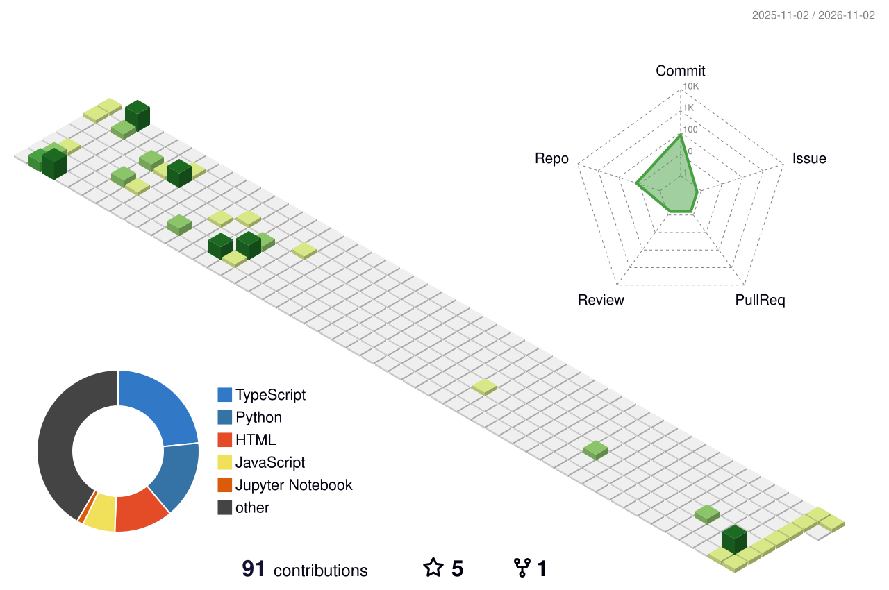

<div align="center">



<a href="https://readme-typing-svg.demolab.com"></a>

</div>

```console
jaiprasad@github:~$ whoami
Jaiprasad Pugazhendi — Full-Stack Developer at LocalsDen, based in India
```

I build web applications end to end: the interface, the API behind it, the database underneath, and the deployment that puts it online. Most of my public work is small-to-mid sized systems with a real workflow at the centre: a billing and inventory system, a CRM with a deal pipeline, a habit tracker with streak logic, a browser extension that encrypts user data locally.

Beyond web apps I'm interested in applied machine learning (computer vision, voice) and the security side of software: authentication, access control and encryption.

```bash
$ cat philosophy.txt
> "Ship deployable systems, not demos."
```

---

```bash
$ ls ~/stack
```

<table>
<tr><td width="14%" valign="middle"><code>languages/</code></td><td>


</td></tr>
<tr><td width="14%" valign="middle"><code>frontend/</code></td><td>


</td></tr>
<tr><td width="14%" valign="middle"><code>backend/</code></td><td>


</td></tr>
<tr><td width="14%" valign="middle"><code>database/</code></td><td>


</td></tr>
<tr><td width="14%" valign="middle"><code>ai-ml/</code></td><td>


</td></tr>
<tr><td width="14%" valign="middle"><code>devops/</code></td><td>


</td></tr>
<tr><td width="14%" valign="middle"><code>tools/</code></td><td>


</td></tr>
</table>

---

```bash
$ ls -l ~/projects
```

```console
drwxr-xr-x  Electronic_shop              billing, inventory and sales analytics (React, TypeScript, Tailwind, Supabase)
drwxr-xr-x  crmtool            [LIVE]    SalesAI CRM: React, TypeScript, Node, Express, MongoDB, on Vercel
drwxr-xr-x  secureformx                  Chrome extension: autofill from locally encrypted profiles (AES-256-GCM, PBKDF2)
drwxr-xr-x  habit_tracker                Flask + SQLite habit tracker with streak logic and Chart.js analytics
drwxr-xr-x  based-on-face-recognition    face shape recognition with CNN + OpenCV, in a Jupyter notebook
drwxr-xr-x  Finance-Tracker              personal finance tracker
drwxr-xr-x  voice-clone-tts              local, offline text-to-speech voice cloning in Python
drwxr-xr-x  jaiprasaad_portfolio [LIVE]  personal portfolio site
```

<sub>One-line descriptions come from each repository's own README. Source and live links:</sub>

| repo | source | live |
|---|---|---|
| `Electronic_shop` | [github](https://github.com/Jaiprasadpugazhendi/Electronic_shop) | n/a |
| `crmtool` | [github](https://github.com/Jaiprasadpugazhendi/crmtool) | [crmtool-nine.vercel.app](https://crmtool-nine.vercel.app) |
| `secureformx` | [github](https://github.com/Jaiprasadpugazhendi/secureformx) | n/a |
| `habit_tracker` | [github](https://github.com/Jaiprasadpugazhendi/habit_tracker) | n/a |
| `based-on-face-recognition` | [github](https://github.com/Jaiprasadpugazhendi/based-on-face-recognition) | n/a |
| `Finance-Tracker` | [github](https://github.com/Jaiprasadpugazhendi/Finance-Tracker) | n/a |
| `voice-clone-tts` | [github](https://github.com/Jaiprasadpugazhendi/voice-clone-tts) | n/a |
| `jaiprasaad_portfolio` | [github](https://github.com/Jaiprasadpugazhendi/jaiprasaad_portfolio) | [jaiprasaad-portfolio.vercel.app](https://jaiprasaad-portfolio.vercel.app) |

---

```bash
$ cat ~/ventures.md
```

```markdown
- LocalsDen    Full-Stack Developer (current role). Web apps, backend APIs, database work.
- NicheNotch   Co-Founder. Product strategy and technical build of digital products.
- Modust-Trio  Founder and lead builder. Modular web apps deployed on Vercel.
- Freelance    Web, app, AI automation and SEO work, scoped as deliverables.
```

---

```bash
$ git log --stat --author="Jaiprasadpugazhendi"
```

<div align="center">


</div>

---

```bash
$ ./contrib-skyline --3d
```

<div align="center">



</div>

---

```bash
$ contact --me
```

```console
email     mail2jaiprasadp@gmail.com
linkedin  linkedin.com/in/jaiprasadp
github    github.com/Jaiprasadpugazhendi
base      India
```

<div align="center">

<a href="https://github.com/Jaiprasadpugazhendi"><b>GITHUB</b></a> &nbsp;·&nbsp;
<a href="https://www.linkedin.com/in/jaiprasadp/"><b>LINKEDIN</b></a> &nbsp;·&nbsp;
<a href="https://jaiprasaad-portfolio.vercel.app"><b>PORTFOLIO</b></a> &nbsp;·&nbsp;
<a href="mailto:mail2jaiprasadp@gmail.com"><b>EMAIL</b></a>

```console
jaiprasad@github:~$ _
```

</div>
