


 

<a href="https://github.com/Jaiprasadpugazhendi"><b>GITHUB</b></a> &nbsp;·&nbsp;
<a href="https://www.linkedin.com/in/jaiprasadp/"><b>LINKEDIN</b></a> &nbsp;·&nbsp;
<a href="https://jaiprasaad-portfolio.vercel.app"><b>PORTFOLIO</b></a> &nbsp;·&nbsp;
<a href="mailto:mail2jaiprasadp@gmail.com"><b>EMAIL</b></a>

BASE: INDIA

 

**CONTENTS**

<a href="#about">01 About</a> · <a href="#philosophy">02 Philosophy</a> · <a href="#architecture">03 Architecture</a> · <a href="#arsenal">04 Technical Arsenal</a> · <a href="#projects">05 Featured Projects</a> 
<a href="#experience">06 Experience</a> · <a href="#analytics">07 GitHub Analytics</a> · <a href="#activity">08 Development Activity</a> · <a href="#contact">09 Contact</a>

I'm **Jaiprasad Pugazhendi**, a full-stack developer based in India. I build web applications end to end: the interface, the API behind it, the database underneath, and the deployment that puts it online.

Most of my public work is small-to-mid sized systems with a real workflow at the centre: a billing and inventory system for a shop, a CRM with a deal pipeline, a habit tracker with streak logic, a browser extension that encrypts user data locally. I'm currently a Full-Stack Developer at **LocalsDen**.

Beyond web apps I'm interested in applied machine learning (computer vision, voice) and in the security side of software: authentication, access control and encryption.


<table>
<tr>
<td width="33%" valign="top">

**SHIP, DON'T DEMO** 
A feature is done when it is deployed, authenticated and usable by someone who isn't me.

</td>
<td width="33%" valign="top">

**ARCHITECTURE FIRST** 
Decide where state, trust and data live before writing components. Clear layers make later changes cheap.

</td>
<td width="33%" valign="top">

**SECURE BY DEFAULT** 
Hash credentials, check roles on the server, validate input, encrypt what is sensitive.

</td>
</tr>
</table>


Reference patterns I apply across my projects. Each diagram notes the repositories where the pattern actually appears.






<table>
<tr><td width="18%" valign="middle"><b>LANGUAGES</b></td><td>

</td></tr>
<tr><td valign="middle"><b>FRONTEND</b></td><td>

</td></tr>
<tr><td valign="middle"><b>BACKEND</b></td><td>

</td></tr>
<tr><td valign="middle"><b>DATABASE</b></td><td>

</td></tr>
<tr><td valign="middle"><b>AI &amp; ML</b></td><td>

</td></tr>
<tr><td valign="middle"><b>CLOUD &amp; DEVOPS</b></td><td>

</td></tr>
<tr><td valign="middle"><b>TOOLS</b></td><td>

</td></tr>
</table>


Descriptions are taken from each repository's own README. Live links appear only where a deployment exists.


**[Source: Electronic_shop](https://github.com/Jaiprasadpugazhendi/Electronic_shop)**


**[Source: habit_tracker](https://github.com/Jaiprasadpugazhendi/habit_tracker)**


**[Source: secureformx](https://github.com/Jaiprasadpugazhendi/secureformx)**


**[Source: based-on-face-recognition](https://github.com/Jaiprasadpugazhendi/based-on-face-recognition)**


**[Source: crmtool](https://github.com/Jaiprasadpugazhendi/crmtool)** &nbsp;·&nbsp; **[Live demo](https://crmtool-nine.vercel.app)**

More repositories, including esports_point_maker- (<a href="https://esports-point-maker.vercel.app">live</a>), scene (<a href="https://scene-pi.vercel.app">live</a>), Finance-Tracker and voice-clone-tts, are on <a href="https://github.com/Jaiprasadpugazhendi?tab=repositories">my GitHub</a>.


<table>
<tr>
<td width="22%" valign="top"><b>PRESENT</b> India</td>
<td valign="top">

**Full-Stack Developer, LocalsDen**

- Build and maintain full-stack web applications
- Develop frontend interfaces and backend services
- Design and implement APIs
- Contribute to product development and ongoing maintenance

</td>
</tr>
</table>


**3D CONTRIBUTION SKYLINE**


<table>
<tr>
<td width="33%" valign="top">

**CURRENTLY BUILDING** 

`voice-clone-tts`: a local, offline text-to-speech voice cloning system in Python.  
`crmtool`: SalesAI CRM, a full-stack CRM with an AI email assistant.

</td>
<td width="33%" valign="top">

**CURRENTLY LEARNING** 

Applied ML and computer vision (CNNs, OpenCV), as in `based-on-face-recognition`.  
Applied cryptography in the browser (Web Crypto, PBKDF2, AES-GCM), as in `secureformx`.

</td>
<td width="33%" valign="top">

**ENGINEERING INTERESTS** 

Software architecture 
Authentication and access control 
Data visualisation and analytics dashboards (`habit_tracker`) 
Deployable, production-minded full-stack apps

</td>
</tr>
</table>




<a href="https://github.com/Jaiprasadpugazhendi"><b>GITHUB</b></a> &nbsp;·&nbsp;
<a href="https://www.linkedin.com/in/jaiprasadp/"><b>LINKEDIN</b></a> &nbsp;·&nbsp;
<a href="https://jaiprasaad-portfolio.vercel.app"><b>PORTFOLIO</b></a> &nbsp;·&nbsp;
<a href="mailto:mail2jaiprasadp@gmail.com"><b>EMAIL</b></a>

`mail2jaiprasadp@gmail.com`

